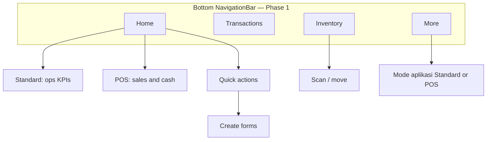

# Aria mobile — app design direction (Material 3)

**Audience:** Product + Flutter implementation  

**Visual references:** dark dashboard mockups (rounded cards, quick-action grid). Images: Project Context `media/mobile-dashboard-mockup-teal.jpg`, `media/mobile-dashboard-mockup-green-header.jpg`.

**Stack:** Flutter **Material 3** (`useMaterial3: true`, `NavigationBar`, `Card`, `FilledButton`, outline text fields). Teal accents aligned with web Aria; appearance via `PATCH /api/mobile/v1/preferences/appearance`.

**Companion doc:** [`mobile-transaction-form-ux.md`](mobile-transaction-form-ux.md) (field layout; separate from home shell).

---

## Product scope

### Phase 1 — core ops

| Domain | Actions | Mobile entry |
|--------|---------|----------------|
| **Cash management** | Cash in, cash out, transfer | Quick actions + FAB + forms |
| **Inventory management** | Buy, sell, move stock | Same; **POS** = sell + barcode (mode toggle, not a second app) |

UI gated by `mobile_actions` from `GET /api/mobile/v1/me`.

### Phase 2 — later

Reports (read-only), user/ACL (admin), optional Jubelio/restock/produksi tiles when dashboard KPIs allow.

---

## Information architecture



| Tab | Purpose |
|-----|---------|
| **Home** | **Standard (default):** simplified Aria dashboard. **POS:** mockup sales/cash home |
| **Transactions** | List + detail |
| **Inventory** | Scan, move, stock shortcuts |
| **More** | Theme, **Mode aplikasi**, logout; future reports/users |

Replace the current 2-tab shell (`Dashboard` / `Transactions`) with this 4-tab shell when implementing.

---

## Home modes (single source of truth)

| Setting | Storage (v1) | Who |
|---------|----------------|-----|
| **Standard** (default) | `SharedPreferences` `mobile_home_mode=standard` | Warehouse, admin, mixed roles |
| **POS** | `mobile_home_mode=pos` | Counter / retail |

Toggle: **More → Mode aplikasi**. Optional later: `preferences.mobile_home_mode` on server.

**Rule:** Do **not** show daily **cash totals, sell/buy amounts, cash-flow chart, or recent sales with amounts** on Home in **Standard** mode. Those belong to **POS** mode only (or the Transactions tab for history).

---

## Home — Standard (default)

Data: `GET /api/mobile/v1/dashboard` → `MobileDashboardPresenter` (same families as web ops dashboard / today’s `DashboardScreen`).

1. **Greeting** — welcome + username.
2. **KPI cards** (permission-gated, hide if empty): Queue, Jubelio, Stock alerts, Book closing, Restock, Produksi.
3. **Aktivitas (optional)** — **counts only** (`sell_count`, `buy_count`). Do **not** show `sell_total`, `buy_total`, `cash_in_total`, `cash_out_total`.
4. **Quick actions** — equal-weight shortcuts for each permitted create action (sell, buy, move, cash in/out, transfer).
5. **Excluded:** finance hero, weekly chart, recent txn amount list (use **Transactions** tab).

Pull-to-refresh; M3 card styling only — no new KPI semantics.

**FAB:** “Buat” → `CreateTransactionSheet` (all permitted types).

---

## Home — POS mode

Uses mockup layout when `mobile_home_mode == pos`.

### Hero (from `kpis.activity_today` when allowed)

| Label | Fields |
|-------|--------|
| Penjualan hari ini | `sell_total`, `sell_count` |
| Kas masuk / keluar hari ini | `cash_in_total`, `cash_out_total` |
| Net kas hari ini | in − out |

IDR formatting; optional hide amounts (eye icon, local pref). Teal/green gradient card per mockup.

### Quick actions (POS)

**Jual** first and prominent → `SellFormScreen` (scanner primary). Other actions in secondary row or overflow.

### Cash flow and recent (POS only)

- **Minggu ini** chart when daily series exist (API or client roll-up); v0 may omit chart.
- **Recent sales** — last sells with amounts; filter client- or server-side when available.

---

## Forms and POS entry

- **Forms:** [`mobile-transaction-form-ux.md`](mobile-transaction-form-ux.md) — spacing shipped; next: collapsible sections + sticky submit.
- **POS sell:** preference prefill, scanner-first, landscape two-column line fields when width > 600dp.

---

## Material 3 (Flutter)

```dart
ThemeData(
  useMaterial3: true,
  colorScheme: ColorScheme.fromSeed(
    seedColor: const Color(0xFF0D9488),
    brightness: brightness,
  ),
)
```

Card radius ~16; min touch target 48dp; Indonesian labels (`Jual`, `Beli`, `Kas masuk`); IDR number format.

Amount colors on screen are **display only** — server sign convention unchanged.

---

## API notes

| Need | Available today | Notes |
|------|-----------------|-------|
| Ops KPIs (Standard home) | `GET /dashboard` | Restyle only |
| Cash/sell totals | `activity_today` | Show on Home **only in POS mode** |
| `mobile_home_mode` | — | Local v1 |
| Weekly cash chart | — | POS mode; needs daily series |
| Recent txns | `GET /transactions` | Standard: Transactions tab; POS: home strip |

---

## Implementation order

1. Theme + tokens  
2. Standard home (default) + POS home branch + mode toggle  
3. Four-tab navigation  
4. Inventory tab shortcuts  
5. Form sections + sticky submit  
6. POS weekly chart (when data exists)  
7. Phase 2 reports/users  

---

## Repo paths

| Area | Path |
|------|------|
| Shell / dashboard today | `lib/screens/shell_screen.dart`, `dashboard_screen.dart` |
| Mobile API | `doc/mobile-api.md` |
| Form spacing | `lib/widgets/transaction_form_fields.dart` |
