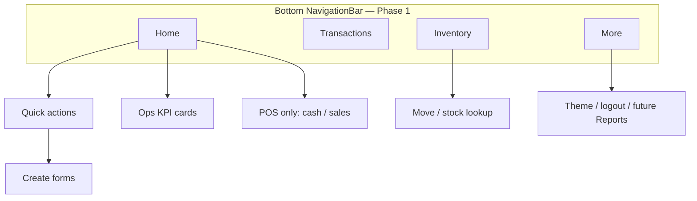

# Aria mobile — app design direction (Material 3)

**Audience:** Product + Flutter implementation  
**Visual references:** maintainer mockups in Project Context `media/mobile-dashboard-mockup-*.jpg` (dark dashboard, rounded cards, quick-action grid).

**Stack:** Flutter **Material 3** (`useMaterial3: true`, `NavigationBar`, `Card`, `FilledButton`, outline text fields). Match Aria web **teal** accents; support light / dark / system via existing `PATCH …/preferences/appearance`.

---

## Product scope

### Phase 1 — ship now (core ops)

| Domain | Actions | Mobile entry |
|--------|---------|----------------|
| **Cash management** | Cash in, cash out, transfer | Quick actions + FAB sheet + dedicated forms |
| **Inventory management** | Buy, sell, move stock | Same; **sell + barcode scan** = dock **POS** (not a separate product yet) |

Permissions continue to gate UI (`mobile_actions` from `/api/mobile/v1/me`).

### Phase 2 — later

- **Reports** (read-only summaries; reuse reporting permissions)
- **User / ACL** (admin-only; unlikely on shared floor devices)
- **Jubelio queue**, restock alerts, produksi — optional tiles when KPI already on dashboard API

---

## Information architecture

**Phase 1 tabs (4):**

| Tab | Purpose |
|-----|---------|
| **Home** | **Standard:** ops KPI dashboard + quick actions. **POS:** mockup sales/cash home |
| **Transactions** | Existing list + detail (filter by type later) |
| **Inventory** | Shortcuts: scan item, move, low-stock count (start with move + barcode lookup) |
| **More** | Theme, logout, placeholders for Reports / Users |

Replace today’s 2-tab shell (`Dashboard` / `Transactions`) with this structure.

---

## Home modes: **Standard** (default) vs **POS**

User-selectable in **More → Mode aplikasi** (v1: `SharedPreferences`; optional later: `preferences.mobile_home_mode` on server).

| Mode | Who | Home emphasis |
|------|-----|----------------|
| **Standard** | Warehouse, admin, mixed roles | **Simplified Aria dashboard** — same KPI families as web / current `DashboardScreen` |
| **POS** | Counter / retail sell | Mockup-style **sales & cash** snapshot + sell-first quick actions |

Do **not** show daily **cash totals, sell/buy amounts, cash-flow chart, or “recent sales” money list** on Home unless mode = **POS**.

---

## Home — Standard (default)

Align with web dashboard ops panels; data from `GET /api/mobile/v1/dashboard` (`MobileDashboardPresenter`).

### Layout (M3 cards, no finance hero)

1. **Greeting** — `Welcome, {name}` (compact `AppBar` or first line).
2. **KPI stack** (permission-gated; hide empty panels):
   - **Queue** — pending jobs, level
   - **Jubelio** — connection, pending / error orders
   - **Stock alerts** — unread count
   - **Book closing** — days until closing
   - **Restock** — alert count (if allowed)
   - **Produksi** — recent count (if allowed)
3. **Optional compact “Aktivitas”** — **counts only** (`sell_count`, `buy_count`); **omit** `sell_total`, `buy_total`, `cash_in_total`, `cash_out_total` in Standard mode.
4. **Quick actions** — one row of permitted create shortcuts (same routes as today); equal weight, **not** sell-only.
5. **No** weekly cash chart, **no** mockup balance hero, **no** recent-transaction amount strip on Home (use **Transactions** tab for history).

Pull-to-refresh; reuse existing `DashboardScreen` data mapping, restyled only.

### FAB (Standard)

Keep **“Buat”** sheet with all permitted transaction types.

---

## Home — POS mode

Use maintainer mockups when `mobile_home_mode == pos`. Retail / counter context only.

### Hero (POS only)

From `kpis.activity_today` when `can.activity`:

| UI label | Source |
|----------|--------|
| **Penjualan hari ini** | `sell_total` + `sell_count` |
| **Kas masuk / keluar hari ini** | `cash_in_total` / `cash_out_total` |
| **Net kas hari ini** | in − out (hero number) |

IDR formatting; optional amount masking (eye icon, local pref). Gradient card per mockup.

### Quick actions (POS)

**Jual** largest / first → `SellFormScreen` (scanner primary). Then Beli, Kas masuk, Kas keluar as needed; transfer/move in overflow sheet.

### Cash flow & recent (POS only)

- **Minggu ini** bar chart when data available (API week buckets or client roll-up); v0 = hero only.
- **Recent sales** — `GET /transactions?per_page=5&type=sell` (filter when API supports; else client-filter), mockup list rows.

---

## Forms & POS

See [`mobile-transaction-form-ux.md`](mobile-transaction-form-ux.md). **POS** = sell flow with scanner as primary CTA and preference prefill.

---

## Material 3 implementation notes

- `ColorScheme.fromSeed(seedColor: Color(0xFF0D9488))`
- Card radius 16, min touch target 48dp
- Indonesian-first labels

---

## Implementation order

1. Theme + tokens  
2. Home redesign — Standard KPI dashboard (default) + POS mode toggle + POS home variant  
3. Four-tab navigation  
4. Inventory tab shortcuts  
5. Form sectioning + sticky submit  
6. Weekly cash chart (**POS mode only**)  
7. Reports / users (Phase 2)
