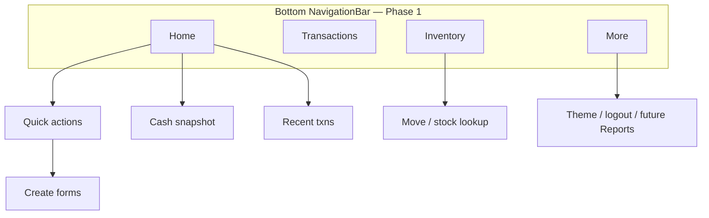

# Aria mobile — app design direction (Material 3)

**Audience:** Product + Flutter implementation  
**Visual references:** maintainer mockups (dark dashboard, rounded cards, quick-action grid). Reference images live in Project Context `media/mobile-dashboard-mockup-*.jpg`.

**Stack:** Flutter **Material 3** (`useMaterial3: true`, `NavigationBar`, `Card`, `FilledButton`, outline text fields). Match Aria web **teal** accents; support light / dark / system via existing `PATCH …/preferences/appearance`.

---

## Product scope

### Phase 1 — ship now (core ops)

| Domain | Actions | Mobile entry |
|--------|---------|----------------|
| **Cash management** | Cash in, cash out, transfer | Quick actions + FAB sheet + dedicated forms |
| **Inventory management** | Buy, sell, move stock | Same; **sell + barcode scan** = dock **POS** (not a separate product yet) |

Permissions continue to gate UI (`mobile_actions` from `/api/mobile/v1/me`).

### Phase 2 — later

- **Reports** (read-only summaries; reuse reporting permissions)
- **User / ACL** (admin-only; unlikely on shared floor devices)
- **Jubelio queue**, restock alerts, produksi — optional tiles when KPI already on dashboard API

---

## Information architecture

**Phase 1 tabs (4):**

| Tab | Purpose |
|-----|---------|
| **Home** | Snapshot + quick actions + recent activity (mockup-style) |
| **Transactions** | Existing list + detail (filter by type later) |
| **Inventory** | Shortcuts: scan item, move, low-stock count (start with move + barcode lookup) |
| **More** | Theme, logout, placeholders for Reports / Users |

Replace today’s 2-tab shell (`Dashboard` / `Transactions`) with this structure; merge current `DashboardScreen` KPI text into **Home** cards.

---

## Home screen — what to display (Aria-specific)

Mockups show **USD total balance** and **Expense**; adapt as follows:

### Hero card (top)

**Option A (recommended v1):** **“Hari ini” (today)** — data already in `GET /api/mobile/v1/dashboard` → `kpis.activity_today`:

| UI label | Source | Notes |
|----------|--------|--------|
| **Kas masuk hari ini** | `cash_in_total` | Format IDR (`NumberFormat.currency(locale: 'id_ID', symbol: 'Rp')`) |
| **Kas keluar hari ini** | `cash_out_total` | Same |
| **Net kas hari ini** | `cash_in_total - cash_out_total` | Hero number (replaces mockup “Total balance”) |
| Optional chips | `sell_count` / `buy_count` | “Jual N · Beli M” |

**Option B (later):** user-pinned **bank balance** (requires mobile endpoint + hidden-balance ACL). Do not fake a single “total balance” without API.

Hero styling: mockup **green/teal gradient card**, eye icon toggles masking amounts (local pref).

### Quick actions (2×2 or horizontal scroll)

Map mockup tiles to Aria actions (permission-gated):

| Tile | Icon color (M3 tonal) | Route |
|------|----------------------|--------|
| **Jual / POS** | Primary (teal) | `SellFormScreen` — emphasize scan |
| **Beli** | Tertiary / orange tonal | `BuyFormScreen` |
| **Kas masuk** | Secondary | `CashFormScreen(cashIn: true)` |
| **Kas keluar** | Error tonal (not “Expense” label) | `CashFormScreen(cashIn: false)` |

Second row (scroll or “More actions” sheet): **Transfer**, **Pindah stok (move)**.

### Cash flow section

Mockup: weekly dual bar chart. **v1:** “Minggu ini” using **seven daily buckets** — needs small API extension or client aggregation from `GET /transactions`. **v0 fallback:** single card **“Aktivitas hari ini”** with the same numbers as hero (no chart).

### Recent transactions

- Leading: type icon in rounded square
- Title: counterparty or warehouse name
- Subtitle: `invoice` · time
- Trailing: display `abs()` amount with color by txn type

Source: `GET /api/mobile/v1/transactions?per_page=5`.

### FAB

Extended FAB **“Buat”** → `CreateTransactionSheet`.

---

## Forms & POS

See [`mobile-transaction-form-ux.md`](mobile-transaction-form-ux.md). **POS** = sell flow with scanner as primary CTA and preference prefill.

---

## Material 3 implementation notes

- `ColorScheme.fromSeed(seedColor: Color(0xFF0D9488))`
- Card radius 16, min touch target 48dp
- Indonesian-first labels

---

## Implementation order

1. Theme + tokens  
2. Home redesign (hero, quick actions, recent txns)  
3. Four-tab navigation  
4. Inventory tab shortcuts  
5. Form sectioning + sticky submit  
6. Weekly cash chart (API or client)  
7. Reports / users (Phase 2)
